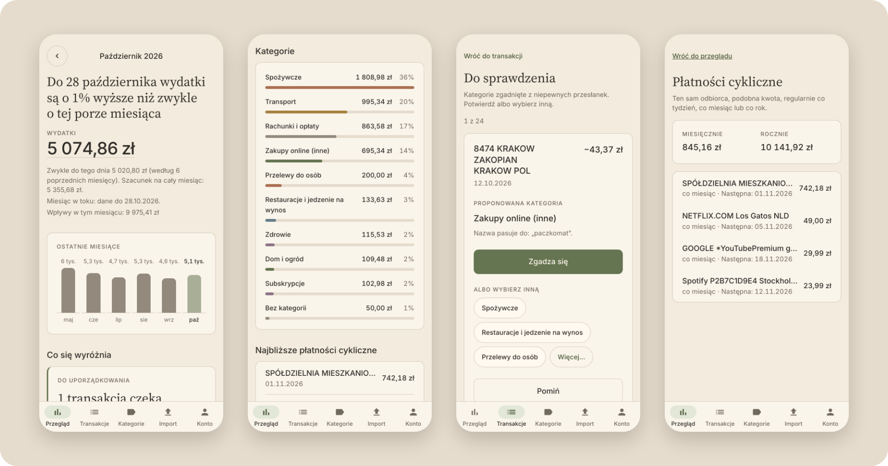
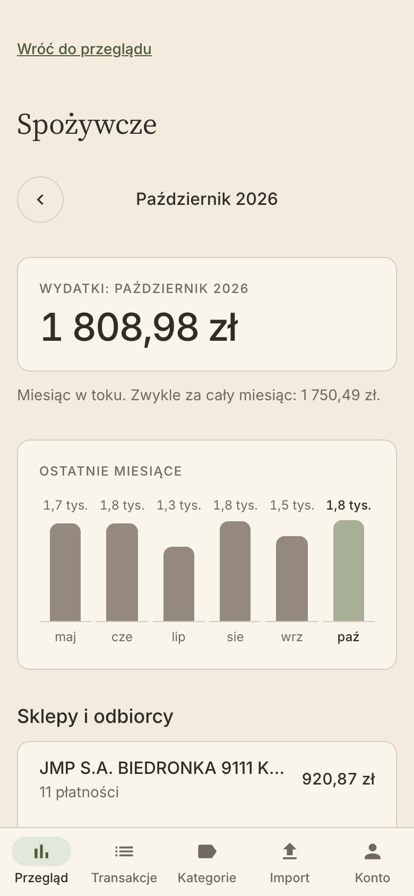
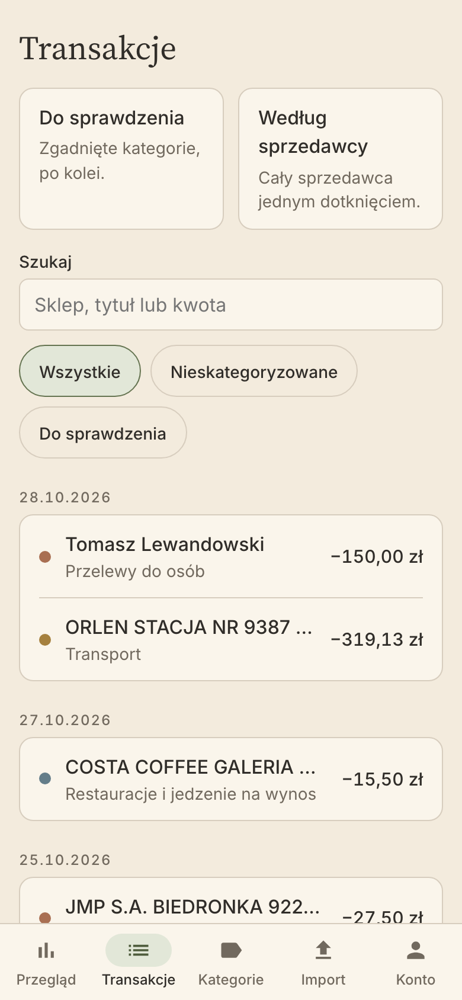
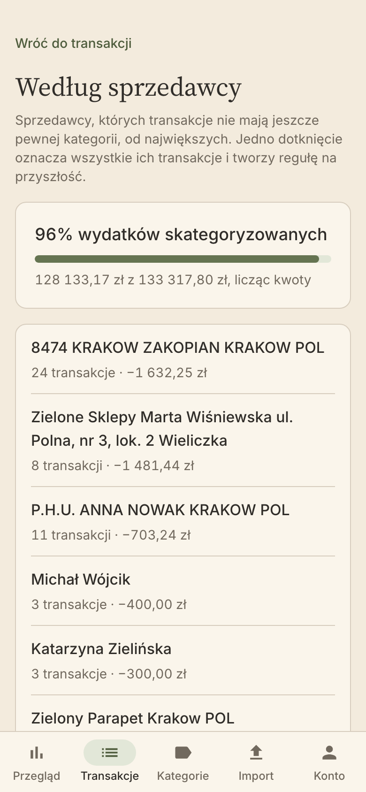
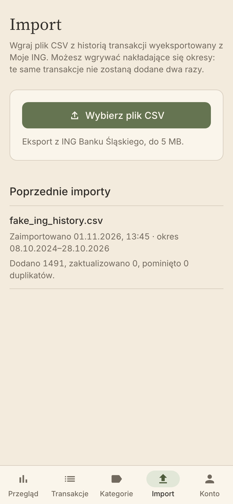
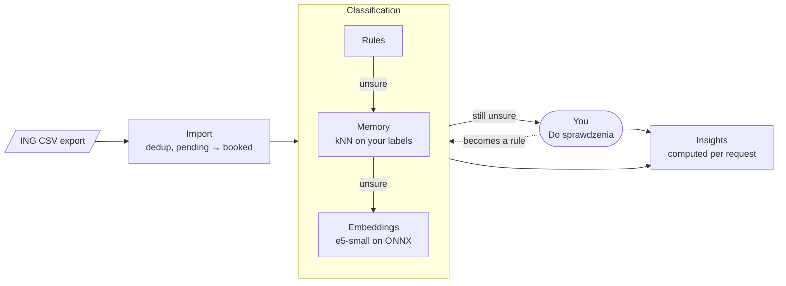

<div align="center">


# expense-insights

**Self-hosted spending insights from your bank's CSV exports.**<br>
Import, classify, correct in one tap, and see where the money went, on your phone.


<picture>
  <source media="(prefers-color-scheme: dark)" srcset="docs/screenshots/hero-dark.png">
  
</picture>

<sub>Screenshots use generated fake data (<code>test-data/fake_ing_history.csv</code>).</sub>

</div>

## What it does

Banks show you a list of transactions. expense-insights turns an export of that list into
answers: *Am I spending more than usual this month? On what? Which subscriptions am I still paying
for?* It runs on a small home server for its owner and a few invited people, and the data never
leaves it.

- **Import without fuss.** Upload the CSV from Moje ING. Overlapping periods are deduplicated,
  pending card holds become booked transactions, and every import is checked against the
  statement's declared totals and running balance. The raw row is kept, so data can be re-parsed
  when the parser improves.
- **Classification that learns from you.** Rules first, then a memory of your own corrections
  (kNN over merchant names), then local embeddings (`multilingual-e5-small` on ONNX Runtime) for
  descriptive local shop names. Each guess explains itself (*„Nazwa pasuje do: paczkomat”*).
- **Corrections in one tap.** Guessed categories wait in *Do sprawdzenia*, one card at a time.
  Fix a whole merchant at once from *Według sprzedawcy*; every correction becomes a rule and
  reclassifies what's still open.
- **Insights, not dashboards.** One headline per month compares your pace with your own baseline
  (the median of previous months), a few ranked insight cards only when something stands out, and
  a drill-down from month → category → merchant → transactions. Recurring payments are detected
  with their next due date.
- **Numbers come from code.** Every amount, sum and percentage is computed deterministically and
  tested. No LLM decides what's unusual or writes a number you see.
- **Mobile-first PWA.** Designed for a 360 px screen, installable, with light and dark themes in
  the *Warm Paper Finance* design system. Polish UI, Polish formatting (`1 234,56 zł`).
- **Private by default.** Google sign-in for invited people only, every query scoped to the
  signed-in user, reachable only through Tailscale.

## Screens

<table>
  <tr>
    <td width="25%"></td>
    <td width="25%"></td>
    <td width="25%"></td>
    <td width="25%"></td>
  </tr>
  <tr>
    <td align="center"><b>Category drill-down</b><br><sub>Total, trend, top merchants</sub></td>
    <td align="center"><b>Transactions</b><br><sub>Search by shop, title or amount</sub></td>
    <td align="center"><b>By merchant</b><br><sub>One tap labels them all</sub></td>
    <td align="center"><b>Import</b><br><sub>Overlaps are deduplicated</sub></td>
  </tr>
</table>

## How it works



One ASP.NET Core API (a modular monolith) and PostgreSQL. The bank-specific parser sits behind an
`IStatementParser` seam, so everything downstream works on a normalised transaction and doesn't
know which bank it came from. Only ING Bank Śląski is supported today; others can be added as their
own `Import.<Bank>` project. Details and the decision log: [`docs/architecture.md`](docs/architecture.md).

| Area | Choice |
|---|---|
| Backend | .NET 10, ASP.NET Core minimal APIs, EF Core |
| Database | PostgreSQL with `pg_trgm` and `pgvector` |
| Frontend | Angular (standalone components, signals), PWA, Transloco (`pl`) |
| Classification | Rules, char n-gram kNN, `multilingual-e5-small` (int8 ONNX) in-process |
| Auth | Google OIDC, invitation-only |
| Hosting | Docker Compose, Caddy, Tailscale; nightly `age`-encrypted backups to Cloudflare R2 |
| Tests | xUnit + Testcontainers, Vitest, Playwright at a phone viewport |

It is built for a modest home server (2-core i3, 8 GB RAM): the embedding model loads on demand
and unloads when idle, and there is no local LLM.

## Getting started

You need the .NET 10 SDK, Node 24 and Docker.

```bash
docker compose -f deploy/docker-compose.yml up -d db       # Postgres with pgvector
dotnet user-secrets --project src/backend/ExpenseInsights.Api set Auth:OwnerEmail you@example.com
dotnet run --project src/backend/ExpenseInsights.Api       # http://localhost:5080, migrates on start
npm --prefix src/frontend ci
npm --prefix src/frontend start                            # http://localhost:4200
```

Open <http://localhost:4200>. Without Google credentials, use the development-only login on the
sign-in page with the owner's address, then import
[`test-data/fake_ing_history.csv`](test-data/) on the **Import** tab to get two years of fake
transactions to explore.

Tests, migrations, the classification accuracy report and the rest of the commands are in
[`AGENTS.md`](AGENTS.md#commands). Production setup (server, Tailscale, DNS, OAuth, backups,
automatic deploys from `main`) is in [`deploy/README.md`](deploy/README.md).

## Project status

A personal project in active development. Import, rule and ML classification, corrections and the
insights screens are built; opt-in cloud insights over aggregates are planned. Progress is tracked
in numbered plans: [`docs/plans/`](docs/plans/README.md).

## Contributing

Start with [`AGENTS.md`](AGENTS.md): the hard rules (money is `decimal`, dates are `DateOnly`,
every query is scoped to the user, numbers never come from an LLM), conventions and commands.
UI work follows [`docs/design-system.md`](docs/design-system.md).

> [!IMPORTANT]
> Never commit real bank data. Only generated data from
> [`test-data/generate_ing_csv.py`](test-data/generate_ing_csv.py) belongs in the repository, and
> `.gitignore` blocks `*.csv` everywhere else.

To refresh the screenshots after a UI change, run `npm --prefix src/frontend run screenshots`
against a dev stack holding only the fake data (the script's header has the steps).
